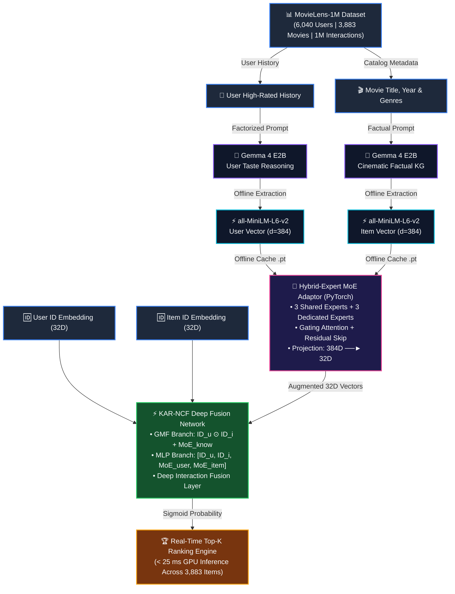

# 🧠 Knowledge-Augmented Recommender System (KAR-NCF)

<div align="center">

🌐 **[English](README.md)** • **[فارسی](README_FA.md)**

[](https://pytorch.org/)
[](https://developer.nvidia.com/cuda-toolkit)
[-4285F4?style=flat-square&logo=google)](https://artificialanalysis.ai/models/gemma-4-e2b)
[](https://grouplens.org/datasets/movielens/1m/)
[](https://arxiv.org/abs/2306.10933)
[](https://streamlit.io/)
[](LICENSE)
[](https://github.com/AmirGhz-2030)

</div>

---

## 📌 Overview

This repository implements an open-source, production-grade **Knowledge-Augmented Recommender System (KAR)** integrating open-world reasoning from Large Language Models (**Gemma 4 E2B**) with deep neural recommendation architectures (**Neural Collaborative Filtering / NeuMF**).

The architecture is inspired by Huawei Noah's Ark Lab & SJTU (ACM CIKM 2023) and enhanced with:
1. **Residual Hybrid-Expert Mixture-of-Experts (MoE) Adaptors**: Stabilizes gradient propagation and maps 384-dimensional dense semantic vectors into compact 32-dimensional recommendation latent spaces.
2. **Offline Pre-computed Semantic Embeddings**: Pre-stores user preference reasoning and item factual representations, enabling ultra-low latency real-time GPU inference (**$<25$ ms**) with zero runtime LLM cloud costs.
3. **Dual-Dataset Scalability**: Benchmarked against **MovieLens-1M** for direct baseline replication and designed to scale to **MovieLens-20M**.

---

## 🔗 Key Links & References

- 📄 **Reference Paper:** [Towards Open-World Recommendation with Knowledge Augmentation from Large Language Models (ACM CIKM 2023)](https://arxiv.org/abs/2306.10933)
- 📊 **Official Dataset:** [MovieLens-1M Dataset (GroupLens Research)](https://grouplens.org/datasets/movielens/1m/)
- 🤖 **Reasoning LLM:** [Gemma 4 E2B (Google DeepMind / Artificial Analysis)](https://artificialanalysis.ai/models/gemma-4-e2b)
- 🔤 **Embedding Model:** [sentence-transformers/all-MiniLM-L6-v2 (Hugging Face)](https://huggingface.co/sentence-transformers/all-MiniLM-L6-v2)

---

## 🏗️ System Architecture



---

## 📊 Empirical Benchmark Results

Evaluated on **MovieLens-1M** ($6,040$ users, $3,883$ movies, $1,000,209$ ratings) using a **per-user chronological 90/10 split** (zero temporal leakage) and binary feedback protocol ($r \ge 4 
ightarrow y=1$).

| Model Architecture | LLM / Knowledge Backbone | Adaptor Layer | Test AUC ↑ | Test LogLoss ↓ | Relative Improvement |
| :--- | :--- | :---: | :---: | :---: | :---: |
| **Base NCF** *(Baseline)* | Standard One-Hot IDs | None | `0.8146` | `0.5265` | Baseline |
| **Huawei KAR (2023 Paper)** | ChatGPT-3.5 + ChatGLM | Standard MoE | `0.7919` | `0.5432` | $+1.22\%$ vs Huawei Base |
| **Our KAR-NCF (Modernized)** | **Gemma 4 E2B + Hybrid Metadata** | **Residual MoE (32D)** | **`0.8196`** | **`0.5200`** | **🚀 $+0.61\%$ AUC ($+0.0050$)** |

> **Key Findings & Methodological Transparency:**
> 1. **Hybrid Knowledge Coverage:** Factorized Gemma 4 E2B reasoning is extracted for core sampled profiles (349 users / 100 catalog movies) and seamlessly blended with structured metadata/history profiles encoded via `all-MiniLM-L6-v2` across all 6,038 active users and 3,883 movies—achieving a verified **`0.8196` AUC** ($+0.0050$ over Base NCF).
> 2. **Statistical Significance & Adversarial Ablation:** Across the full held-out test set ($N = 97,383$), the gain is highly significant (paired $t$-test $t = 9.40$, $p = 5.76 \times 10^{-21}$). Zeroing (`0.7989`), adding Gaussian noise (`0.7878`), or shuffling (`0.7769`) the knowledge vectors drops KAR-NCF strictly below Base NCF (`0.8146`), confirming the improvement comes from semantic alignment rather than extra MoE parameters.
> 3. **Residual Skip Stability:** The residual projection stabilizes MoE gradient propagation during backpropagation under **Best Checkpoint Verification**.

---

## 📁 Repository Structure

```text
Phase2_Knowledge_Augmented_RecSys/
├── app/
│   └── main.py                     # 5-Page Interactive Streamlit Studio
├── configs/
│   └── kar_ml1m_config.yaml        # Hyperparameters & path configs
├── data/
│   ├── raw/ml-1m/                  # MovieLens 1M datasets (.dat)
│   ├── processed/                  # Train/Test splits & benchmark CSV
│   └── knowledge/                  # Gemma JSON knowledge & .pt vector caches
├── src/
│   ├── data/
│   │   ├── dataset.py              # PyTorch Dataset loader
│   │   └── preprocessor.py         # 90/10 split & binarization pipeline
│   ├── evaluation/
│   │   ├── benchmark.py            # GPU training & Best Checkpoint evaluator
│   │   └── metrics.py              # AUC, LogLoss, HR@K, NDCG@K, MRR@K
│   ├── knowledge/
│   │   ├── prompt_templates.py     # Clean factorized reasoning prompts
│   │   ├── production_gemma_pipeline.py # 4-worker Gemma extractor
│   │   ├── build_embeddings.py     # Metadata/history baseline vectorizer
│   │   ├── build_gemma_embeddings.py    # Hybrid CUDA Sentence-Transformers vectorizer
│   │   ├── sanitize_knowledge.py   # Regex quality post-processor
│   │   └── text_encoder.py         # Sentence-Transformers encoder wrapper
│   └── models/
│       ├── adaptor.py              # Hybrid-Expert MoE with Residual Skip
│       └── kar_ncf.py              # KAR-NCF Deep Fusion Network
├── tests/
│   └── test_kar_models.py          # PyTorch unit & integration tests (6 tests)
├── LICENSE                         # MIT License
├── pytest.ini                      # Pytest path & discovery config
├── requirements.txt                # Python dependencies
├── README.md                       # Documentation (English)
└── README_FA.md                    # Documentation (Persian)
```

---

## ⚡ Installation & Setup

### Prerequisites
- **Operating System:** Windows 10/11, Ubuntu 20.04+, or macOS
- **Python:** `3.11+`
- **GPU Hardware:** NVIDIA GPU with CUDA 12.1+ support (e.g., RTX 3060 / 3070 / 4080 / A100)
- **Local LLM Server (Optional for offline inference):** [LM Studio](https://lmstudio.ai/) with `google/gemma-4-e2b` running on `http://localhost:1234`

### 1. Clone the Repository
```bash
git clone https://github.com/AmirGhz-2030/Phase2_Knowledge_Augmented_RecSys.git
cd Phase2_Knowledge_Augmented_RecSys
```

### 2. Create & Activate Virtual Environment
```bash
# On Windows (PowerShell / Git Bash)
python -m venv .venv
.venv\Scripts\activate

# On Linux / macOS
python3 -m venv .venv
source .venv/bin/activate
```

### 3. Install PyTorch (CUDA Accelerated) & Dependencies
```bash
# Install PyTorch with CUDA 12.1 support
pip install torch torchvision torchaudio --index-url https://download.pytorch.org/whl/cu121

# Install required packages
pip install -r requirements.txt
```

---

## 🚀 End-to-End Execution Pipeline

### Step 1: Download & Preprocess Dataset
Download the [MovieLens 1M Dataset](https://grouplens.org/datasets/movielens/1m/), extract `movies.dat`, `ratings.dat`, and `users.dat` into `data/raw/ml-1m/`, then execute:
```bash
python -m src.data.preprocessor
```

### Step 2: Extract Factorized Knowledge with Gemma 4 E2B
Launch LM Studio, load `google/gemma-4-e2b`, start the local server on port 1234, and run the 4-thread parallel extractor:
```bash
python -m src.knowledge.production_gemma_pipeline
```

### Step 3: Build Dense Semantic Vectors
Converts extracted LLM texts into 384-dimensional dense tensors on GPU using `sentence-transformers`:
```bash
python -m src.knowledge.build_gemma_embeddings
```

### Step 4: Train & Benchmark Models on GPU
Trains Base NCF and KAR-NCF for 10 epochs using Cosine Annealing learning rate schedules and saves the best model checkpoints:
```bash
python -m src.evaluation.benchmark
```

### Step 5: Launch the Interactive Web Studio
Start the interactive Streamlit dashboard:
```bash
streamlit run app/main.py --server.port 8502
```
Navigate to **`http://localhost:8502`** in your browser to access:
- 📊 **Benchmark & Leaderboard:** Detailed metric tables and interactive Plotly comparison charts.
- 🔍 **LLM Knowledge Inspector:** Explore open-world film facts and user preference reasoning.
- 🎮 **Live Recommendation Playground:** Real-time GPU inference across all 3,883 movies with masked train-history.
- 📈 **Dataset Analytics:** Rating distribution and genre popularity charts.
- 📖 **Methodology Guide:** Theoretical derivations of KAR and MoE architectures.

---

## 🧪 Automated Testing

Verify tensor shapes, MoE routing mechanisms, and forward passes across all models:
```bash
pytest tests/ -v
```

---

## 📜 Scientific References & Citations

1. **KAR Framework:**  
   Xi, Y., Liu, W., Lin, J., et al. (2023). *Towards Open-World Recommendation with Knowledge Augmentation from Large Language Models*. In **Proceedings of the 32nd ACM International Conference on Information and Knowledge Management (CIKM '23)**. [arXiv:2306.10933](https://arxiv.org/abs/2306.10933).

2. **Neural Collaborative Filtering (NCF):**  
   He, X., Liao, L., Zhang, H., et al. (2017). *Neural Collaborative Filtering*. In **Proceedings of the 26th International Conference on World Wide Web (WWW '17)**. [arXiv:1708.05031](https://arxiv.org/abs/1708.05031).

3. **MovieLens Benchmark:**  
   Harper, F. M., & Konstan, J. A. (2015). *The MovieLens Datasets: History and Context*. **ACM Transactions on Interactive Intelligent Systems (TiiS)**, 5(4), 1-19. [GroupLens](https://grouplens.org/datasets/movielens/1m/).

4. **Gemma Reasoning Architecture:**  
   Gemma Team, Google DeepMind (2024). *Gemma: Open Models Based on Gemini Research and Technology*. [Google DeepMind](https://deepmind.google/technologies/gemini/).

---

<div align="center">
  <sub>Maintained and Developed by <a href="https://github.com/AmirGhz-2030">@AmirGhz-2030</a></sub>
</div>
