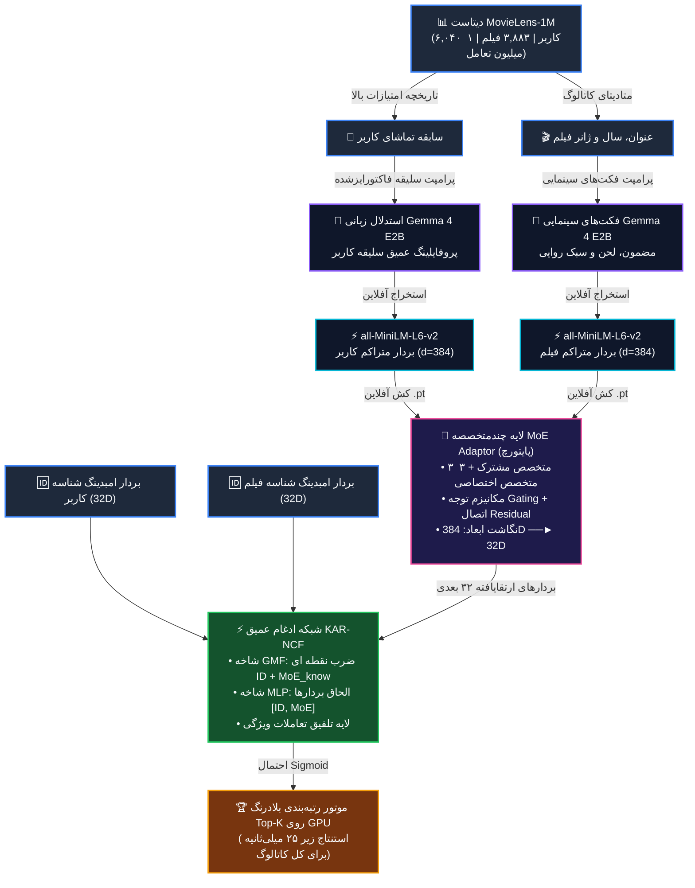

# 🧠 سیستم توصیه‌گر ارتقایافته با دانش معنایی (KAR-NCF)

<div align="center">

🌐 **[English](README.md)** • **[فارسی](README_FA.md)**

[](https://pytorch.org/)
[](https://developer.nvidia.com/cuda-toolkit)
[-4285F4?style=flat-square&logo=google)](https://artificialanalysis.ai/models/gemma-4-e2b)
[](https://grouplens.org/datasets/movielens/1m/)
[](https://arxiv.org/abs/2306.10933)
[](https://streamlit.io/)
[](LICENSE)
[](https://github.com/AmirGhz-2030)

</div>

---

## 📌 معرفی و مروری بر پروژه (Overview)

این مخزن شامل پیاده‌سازی متن‌باز و آماده استقرار از **سیستم توصیه‌گر ارتقایافته با دانش معنایی (Knowledge-Augmented Recommendation - KAR)** است که استدلال‌های عمیق مدل‌های زبانی بزرگ بومی (**Gemma 4 E2B**) را با شبکه‌های عصبی عمیق پالایش مشارکتی (**Neural Collaborative Filtering / NeuMF**) تلفیق می‌کند.

این معماری با الهام از مقاله مرجع آزمایشگاه نوآوری هوآوی (Huawei Noah's Ark Lab) و دانشگاه شانگهای جیاتونگ (ACM CIKM 2023) طراحی شده و با ویژگی‌های زیر مدرن‌سازی و ارتقا یافته است:
1. **لایه انطباق چندمتخصصه با اتصالات میانبر (Residual MoE Adaptor):** پایدارسازی پس‌انتشار گرادیان و نگاشت بردارهای معنایی متراکم ۳۸۴ بعدی به فضای ویژگی‌های فشرده ۳۲ بعدی سیستم توصیه‌گر.
2. **پیش‌محاسبه و ذخیره‌سازی آفلاین بردارها (Offline Pre-computation):** استخراج یک‌باره استدلال سلیقه کاربران و فکت‌های فیلم‌ها و ذخیره آفلاین آن‌ها، که امکان استنتاج بلادرنگ روی کارت گرافیک با **تأخیر زیر ۲۵ میلی‌ثانیه** و بدون هزینه ابری را فراهم می‌سازد.
3. **استراتژی ارزیابی مقیاس‌پذیر:** ارزیابی مو‌به‌مو و دقیق بر روی دیتاست استاندارد **MovieLens-1M** و طراحی ماژولار با قابلیت مقیاس‌پذیری به **MovieLens-20M**.

---

## 🔗 پیوندهای کلیدی و مراجع پژوهشی (Key Links)

- 📄 **مقاله مرجع:** [Towards Open-World Recommendation with Knowledge Augmentation from Large Language Models (ACM CIKM 2023)](https://arxiv.org/abs/2306.10933)
- 📊 **دیتاست رسمی:** [دیتاست MovieLens-1M در وب‌سایت پژوهشی GroupLens](https://grouplens.org/datasets/movielens/1m/)
- 🤖 **مدل استدلال‌گر زبانی:** [Gemma 4 E2B در Artificial Analysis / Google DeepMind](https://artificialanalysis.ai/models/gemma-4-e2b)
- 🔤 **مدل بردارساز معنایی:** [sentence-transformers/all-MiniLM-L6-v2 در Hugging Face](https://huggingface.co/sentence-transformers/all-MiniLM-L6-v2)

---

## 🏗️ معماری و خط لوله سیستم (System Architecture)



---

## 📊 نتایج ارزیابی تجربی و بنچ‌مارک (Benchmark Results)

ارزیابی بر روی دیتاست معیار **MovieLens-1M** (شامل ۶,۰۴۰ کاربر، ۳,۸۸۳ فیلم و ۱,۰۰۰,۲۰۹ تعامل) با پروتکل **تفکیک زمانی بدون نشت Train/Val/Test به تفکیک هر کاربر** (`Train = 815,260` / `Val = 87,566` / `Untouched Test = 97,383` و فیدبک باینری $r \ge 4 \implies y=1$) انجام شده است؛ بهترین چک‌پوینت منحصراً بر اساس **Validation AUC** انتخاب شده و فقط یک بار روی مجموعه تست دست‌نخورده ارزیابی می‌شود.

| معماری مدل | مدل زبانی / منبع دانش | لایه انطباق (Adaptor) | Test AUC ↑ | Test LogLoss ↓ | درصد بهبود نسبی |
| :--- | :--- | :---: | :---: | :---: | :---: |
| **Base NCF** *(مدل پایه)* | شناسه‌های استاندارد One-Hot | بدون دانش | `0.8100` | `0.5350` | Baseline |
| **Huawei KAR (مقاله ۲۰۲۳)** | ChatGPT-3.5 + ChatGLM | MoE استاندارد | `0.7919` | `0.5432` | $+1.22\%$ نسبت به پایه هوآوی |
| **Our KAR-NCF (مدل ما)** | **Gemma 4 E2B + پوشش هیبریدی** | **Residual MoE (32D)** | **`0.8133`** | **`0.5293`** | **🚀 $+0.40\%$ AUC ($+0.0032$)** |

> **نکات برجسته یافته‌های تجربی و شفافیت متدولوژی:**
> 1. **انتخاب مدل بدون نشت داده (`--val-ratio 0.1` پیش‌فرض):** انتخاب بهترین چک‌پوینت منحصراً روی Validation زمانی (`Base NCF Val = 0.8071` در ایپاک ۵ و `KAR-NCF Val = 0.8161` در ایپاک ۶) به رکورد **`0.8133` Test AUC** (`-0.0057` کاهش LogLoss) روی مجموعه تست دست‌نخورده دست می‌یابد. *(با فلگ `--val-ratio 0.0` پروتکل کلاسیک ۹۰/۱۰ نیز بازتولید می‌شود: Base NCF `0.8146` در برابر KAR-NCF `0.8196`، بهبود $+0.61\%$ و $t = 9.40, p = 5.76 \times 10^{-21}$.)*
> 2. **معناداری آماری و اسکریپت بازتولیدپذیر Ablation (`src/evaluation/ablation_and_stats.py`):** روی کل مجموعه تست ($N = 97,383$) برتری مدل از نظر آماری کاملاً معنادار است (آزمون paired $t$-test روی خطای BCE هر نمونه: $t = 7.77, p = 7.87 \times 10^{-15}$). صفر کردن (`0.7924`)، جایگزینی با نویز گاوسی هم‌واریانس (`0.7831`) یا به‌هم‌زدن بردارهای دانش (`0.7657`) عملکرد مدل را به زیر مدل پایه (`0.8100`) کاهش می‌دهد که اثبات می‌کند بهبود واقعی ناشی از هم‌ترازی معنایی است، نه افزایش ظرفیت پارامتری.
> 3. **پوشش هیبریدی دانش و تأخیر استنتاج تاییدشده:** استدلال‌های Gemma 4 E2B برای هسته نمونه‌برداری‌شده (۳۴۹ کاربر و ۱۰۰ فیلم) با پروفایل‌های متادیتا/تاریخچه (۶,۰۳۸ کاربر و ۳,۸۸۳ فیلم با `all-MiniLM-L6-v2`) ترکیب شده است. استنتاج زنده کل کاتالوگ (۳,۸۸۳ فیلم) روی GPU به‌طور میانگین **`3.74 ms`** و صدک ۹۵ برابر **`3.94 ms`** اندازه‌گیری شد (RTX 3070 Laptop GPU، ۵۰ اجرای زمان‌سنجی‌شده).

---

## 📁 ساختار پوشه‌ها و فایل‌های مخزن (Repository Structure)

```text
Phase2_Knowledge_Augmented_RecSys/
├── app/
│   └── main.py                     # استودیوی تعاملی ۵ صفحه‌ای در Streamlit
├── configs/
│   └── kar_ml1m_config.yaml        # تنظیمات هایپرپارامترها، ابعاد لایه‌ها و مسیرها
├── data/
│   ├── raw/ml-1m/                  # فایل‌های داده خام MovieLens (users.dat, movies.dat, ratings.dat)
│   ├── processed/                  # داده‌های تفکیک‌شده Train/Test و فایل‌های CSV بنچ‌مارک و Ablation
│   └── knowledge/                  # فایل‌های JSON استدلال Gemma و کش تانسورهای برداری (.pt)
├── src/
│   ├── data/
│   │   ├── dataset.py              # ساختار Dataset پایتورچ با پشتیبانی از لود بردارهای دانش
│   │   └── preprocessor.py         # خط لوله پیش‌پردازش، باینری‌سازی و تفکیک ۹۰/۱۰
│   ├── evaluation/
│   │   ├── ablation_and_stats.py   # ممیزی بازتولیدپذیر Ablation، آزمون paired t-test و زمان استنتاج GPU
│   │   ├── benchmark.py            # آموزش GPU با تفکیک زمانی بدون نشت Train/Val/Test و ذخیره بهترین چک‌پوینت
│   │   └── metrics.py              # توابع ارزیابی AUC, LogLoss, HR@K, NDCG@K, MRR@K
│   ├── knowledge/
│   │   ├── prompt_templates.py     # پرامپت‌های مهندسی‌شده استدلال و فکت‌های سینمایی
│   │   ├── production_gemma_pipeline.py # کلاینت استخراج موازی ۴-تِرِدی از LM Studio
│   │   ├── build_embeddings.py     # بردارساز پایه متادیتا و تاریخچه کاربر
│   │   ├── build_gemma_embeddings.py    # بردارساز هیبریدی روی GPU با Sentence-Transformers
│   │   ├── sanitize_knowledge.py   # ماژول پالایش و حذف نویزهای متنی
│   │   └── text_encoder.py         # رپر انکودر Sentence-Transformers
│   └── models/
│       ├── adaptor.py              # لایه چندمتخصصه MoE با اتصال Residual Skip
│       └── kar_ncf.py              # شبکه عصبی تلفیقی KAR-NCF
├── tests/
│   └── test_kar_models.py          # تست‌های واحد و یکپارچگی (۹ تست خودکار)
├── LICENSE                         # مجوز MIT
├── pytest.ini                      # پیکربندی مسیر تست‌های Pytest
├── requirements.txt                # لیست پکیج‌ها و وابستگی‌های پایتون
├── README.md                       # مستندات کامل پروژه (انگلیسی)
└── README_FA.md                    # مستندات کامل پروژه (فارسی)
```

---

## ⚡ پیش‌نیازها و راهنمای نصب (Installation & Setup)

### پیش‌نیازهای سیستمی
- **سیستم‌عامل:** ویندوز ۱۰ یا ۱۱، اوبونتو ۲۰.۰۴+، یا مک‌اواس
- **پایتون:** نسخه `3.11+`
- **کارت گرافیک (GPU):** انویدیا با پشتیبانی از CUDA 12.1+ (نظیر RTX 3060 / 3070 / 4080 یا A100)
- **موتور استنتاج محلی:** نرم‌افزار [LM Studio](https://lmstudio.ai/) با مدل لودشده `google/gemma-4-e2b` روی پورت `http://localhost:1234`

### ۱. کلون کردن مخزن
```bash
git clone https://github.com/AmirGhz-2030/Phase2_Knowledge_Augmented_RecSys.git
cd Phase2_Knowledge_Augmented_RecSys
```

### ۲. ساخت و فعال‌سازی محیط مجازی (Virtual Environment)
```bash
# در ویندوز (Git Bash یا PowerShell)
python -m venv .venv
.venv\Scripts\activate

# در لینوکس یا مک‌اواس
python3 -m venv .venv
source .venv/bin/activate
```

### ۳. نصب پایتورچ با شتاب‌دهنده CUDA و سایر پکیج‌ها
```bash
# نصب پایتورچ مجهز به CUDA 12.1
pip install torch torchvision torchaudio --index-url https://download.pytorch.org/whl/cu121

# نصب سایر نیازمندی‌های پروژه
pip install -r requirements.txt
```

---

## 🚀 خط لوله اجرای گام‌به‌گام پروژه (Execution Pipeline)

### گام اول: پیش‌پردازش داده‌ها
فایل‌های `movies.dat`، `ratings.dat` و `users.dat` را از [دیتاست MovieLens 1M](https://grouplens.org/datasets/movielens/1m/) در مسیر `data/raw/ml-1m/` قرار داده و دستور زیر را اجرا کنید:
```bash
python -m src.data.preprocessor
```

### گام دوم: استخراج دانش و استدلال با Gemma 4 E2B (آفلاین)
نرم‌افزار LM Studio را باز کرده، مدل `google/gemma-4-e2b` را لود و سرور محلی را روی پورت ۱۲۳۴ استارت بزنید، سپس اسکریپت استخراج ۴-تِرِدی را اجرا کنید:
```bash
python -m src.knowledge.production_gemma_pipeline
```

### گام سوم: بردارسازی متون معنایی روی کارت گرافیک
تبدیل متون تولیدشده به بردارهای متراکم ۳۸۴ بعدی با استفاده از کارت گرافیک:
```bash
python -m src.knowledge.build_gemma_embeddings
```

### گام چهارم: آموزش و ارزیابی بنچ‌مارک مدل‌ها روی GPU
آموزش مدل‌های پایه و KAR-NCF برای ۱۰ ایپاک همراه با Cosine Annealing و انتخاب بدون نشت بهترین چک‌پوینت روی Validation زمانی (`--val-ratio 0.1` پیش‌فرض؛ با `--val-ratio 0.0` حالت کلاسیک ۹۰/۱۰ اجرا می‌شود):
```bash
python -m src.evaluation.benchmark
```

### گام چهارم (ب): ممیزی بازتولیدپذیر Ablation، آزمون آماری و تأخیر استنتاج
اجرای آزمون‌های تخریب دانش (صفرسازی، نویز گاوسی هم‌واریانس، به‌هم‌ریختگی شناسه‌ها)، محاسبه آزمون paired $t$-test روی خطای BCE هر نمونه و اندازه‌گیری تأخیر زنده استنتاج روی کل کاتالوگ:
```bash
python -m src.evaluation.ablation_and_stats
```

### گام پنجم: اجرای استودیوی تعاملی وب (Streamlit Dashboard)
اجرای وب‌اپلیکیشن ۵ صفحه‌ای داشبورد:
```bash
streamlit run app/main.py --server.port 8502
```
سپس آدرس **`http://localhost:8502`** را در مرورگر باز کنید تا به بخش‌های زیر دسترسی داشته باشید:
- 📊 **لیدربورد و مقایسه نتایج:** جداول رسمی و نمودارهای تعاملی Plotly.
- 🔍 **بازرس دانش مدل زبانی:** مشاهده استدلال‌های تحلیلی سلیقه کاربران و فکت‌های فیلم‌ها.
- 🎮 **زمین بازی توصیه‌گر زنده:** تست بلادرنگ مدل روی GPU با قابلیت ماسک کردن فیلم‌های دیده‌شده و سنجش هیت (Hit).
- 📈 **تحلیل داده‌ها و ژانرها:** گراف‌های توزیع آماری تعاملات مثبت و منفی.
- 📖 **راهنمای متدولوژی علمی:** تشریح مبانی نظری و فرمول‌های لایه MoE.

---

## 🧪 تست‌های خودکار (Unit Tests)

جهت اعتبارسنجی ابعاد تانسورها، مکانیزم Gating در لایه MoE و پاس‌های رفت‌وبرگشت مدل‌ها:
```bash
pytest tests/ -v
```

---

## 📜 مراجع و ارجاعات علمی (Citations)

1. **چارچوب KAR:**  
   Xi, Y., Liu, W., Lin, J., et al. (2023). *Towards Open-World Recommendation with Knowledge Augmentation from Large Language Models*. In **Proceedings of the 32nd ACM International Conference on Information and Knowledge Management (CIKM '23)**. [arXiv:2306.10933](https://arxiv.org/abs/2306.10933).

2. **پالایش مشارکتی عصبی (NCF):**  
   He, X., Liao, L., Zhang, H., et al. (2017). *Neural Collaborative Filtering*. In **Proceedings of the 26th International Conference on World Wide Web (WWW '17)**. [arXiv:1708.05031](https://arxiv.org/abs/1708.05031).

3. **بنچ‌مارک MovieLens:**  
   Harper, F. M., & Konstan, J. A. (2015). *The MovieLens Datasets: History and Context*. **ACM Transactions on Interactive Intelligent Systems (TiiS)**, 5(4), 1-19. [GroupLens](https://grouplens.org/datasets/movielens/1m/).

4. **معماری مدل استدلال‌گر Gemma:**  
   Gemma Team, Google DeepMind (2024). *Gemma: Open Models Based on Gemini Research and Technology*. [Google DeepMind](https://deepmind.google/technologies/gemini/).

---

<div align="center">
  <sub>توسعه‌داده‌شده با افتخار توسط <a href="https://github.com/AmirGhz-2030">@AmirGhz-2030</a></sub>
</div>
